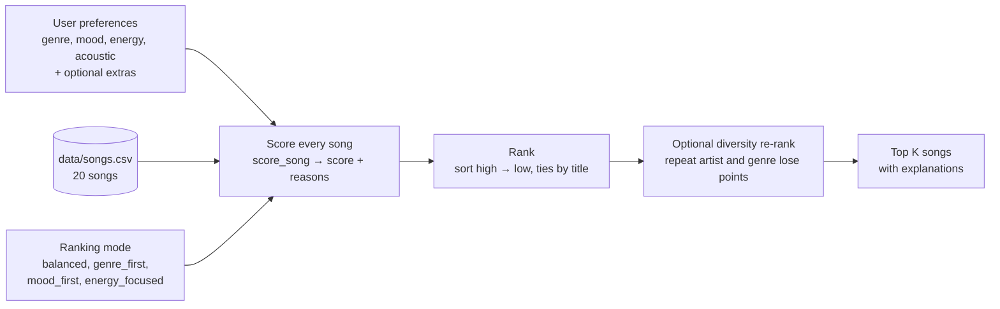

# 🎵 Music Recommender Simulation

## Project Summary

In this project you will build and explain a small music recommender system.

Your goal is to:

- Represent songs and a user "taste profile" as data
- Design a scoring rule that turns that data into recommendations
- Evaluate what your system gets right and wrong
- Reflect on how this mirrors real world AI recommenders

**VibeFinder 1.0** is a content-based music recommender. It reads a 20-song catalog (`data/songs.csv`), scores every song against one listener's stated taste (favorite genre, favorite mood, a target energy level, and whether they like acoustic sounds), ranks the songs, and prints the top results with a plain-language reason for every point. It uses no listening history and no other users' data, so every recommendation can be traced back to a rule you can read in `score_song`. Three optional extras sit on top of that core: switchable ranking modes, a diversity re-rank, and five extra song attributes with matching optional preferences. All three are off by default, and with them off the results are the same as the core recipe's.

---

## How The System Works

Real platforms like Spotify and YouTube use hybrid filtering, which combines collaborative filtering (recommending what listeners with similar behavior enjoyed) with content-based filtering (recommending songs whose attributes resemble ones you already like). The **input data** is what the system knows about each song, such as its genre, mood, tempo, energy, and acousticness. The **user preferences** come from what a listener says and does: explicit signals like likes and playlist adds, and implicit signals like plays, skips, and replays. The **ranking** step scores every candidate song for how likely the listener is to enjoy it, sorts the list, and re-orders it for variety before showing the top results. VibeFinder is content-based only. It scores genre, mood, energy, and acousticness against one user's stated preferences. The tradeoff is that it can't learn from what a user actually plays or skips, and it can't discover cross-genre picks from other listeners' taste, so it only crosses genres when songs share attributes like energy.

### Features used in this simulation

**`Song`** (one row of `data/songs.csv`)

| Feature | Type | Used for scoring? |
|---|---|---|
| `genre` | text | Yes |
| `mood` | text | Yes |
| `energy` | 0.0–1.0 | Yes |
| `acousticness` | 0.0–1.0 | Yes |
| `tempo_bpm`, `valence`, `danceability` | numbers | Loaded, not scored yet |
| `popularity`, `release_decade`, `mood_tags`, `instrumentalness`, `explicit` | 0–100, decade, tags, 0.0–1.0, yes/no | Only when the listener sets the matching optional preference |
| `id`, `title`, `artist` | labels | Shown in output only |

**`UserProfile`** (one listener's stated taste)

| Field | Example | Meaning |
|---|---|---|
| `favorite_genre` | `"pop"` | Genre the listener wants most |
| `favorite_mood` | `"happy"` | Mood the listener wants |
| `target_energy` | `0.8` | Energy level to get close to (not "the higher the better") |
| `likes_acoustic` | `False` | Whether acoustic songs should earn points or lose them |
| `decade` | `2020` | Optional. Release decade to match |
| `tags` | `["focus", "rainy"]` | Optional. Mood tags to match |
| `wants_instrumental` | `True` | Optional. Prefer songs with little or no singing |
| `avoid_explicit` | `True` | Optional. Penalize explicit songs |
| `popularity` | `"mainstream"` or `"underground"` | Optional. Prefer well-known or little-known songs |

### Algorithm recipe

`score_song` judges one song at a time and adds up points. Every point comes with a reason, so each recommendation can explain itself.

| Factor | Points | Rule |
|---|---|---|
| Genre | **+2.0** exact match, **+1.0** related | "Related" means one genre name contains the other, like "pop" and "indie pop". |
| Mood | **+1.0** | Exact match only. |
| Energy | up to **+1.5** | `1.5 × (1 − \|song energy − target energy\|)`. Closer earns more, so being 0.1 too high costs the same as being 0.1 too low. |
| Acoustic fit | up to **+0.5** | `0.5 × acousticness` if the user likes acoustic songs, `0.5 × (1 − acousticness)` if not. |

In the default `balanced` mode the best possible core score is 5.0. A preference the user doesn't set adds no points.

### Ranking modes

Each mode is a small frozen object of weights (`ScoringMode`). The `MODES` dictionary holds the four modes, and the chosen one is passed into `score_song` and `recommend_songs`. The scoring code never checks a mode name, it only reads the weights (the Strategy pattern). A related genre always earns half of the genre weight.

| Mode | Genre (exact) | Genre (related) | Mood | Energy (max) | Acoustic (max) |
|---|---|---|---|---|---|
| `balanced` | 2.0 | 1.0 | 1.0 | 1.5 | 0.5 |
| `genre_first` | 3.0 | 1.5 | 1.0 | 1.0 | 0.5 |
| `mood_first` | 1.5 | 0.75 | 1.5 | 2.0 | 0.5 |
| `energy_focused` | 1.0 | 0.5 | 1.0 | 3.0 | 0.5 |

`balanced` is the core recipe above and the default.

```python
from src.recommender import load_songs, recommend_songs, MODES

songs = load_songs("data/songs.csv")
prefs = {"genre": "pop", "mood": "happy", "energy": 0.9, "likes_acoustic": False}
results = recommend_songs(prefs, songs, k=5, mode=MODES["mood_first"], diversity=True)
```

### Diversity re-rank (optional)

With `diversity=True`, `recommend_songs` picks songs one at a time. Before each pick it subtracts **1.0** from a candidate for every already-picked song by the same artist and **0.5** for every already-picked song in the same genre (exact matches only), then takes the best adjusted score. The penalty shows up in the reasons, for example `diversity: repeat genre (−0.5)`, so the score still equals the sum of its reasons. It is off by default.

### Optional preferences

These use the five extra song columns. Each one only applies when the listener sets it, and the points are fixed, not scaled by the ranking mode.

| Preference | Points | Rule |
|---|---|---|
| `decade` | **+0.5** | Exact decade match. 1995 never matches 1990. |
| `tags` | **+0.5** per shared tag, capped at **+1.0** | Overlap between the listener's tags and the song's `mood_tags`. A repeated tag counts once. |
| `wants_instrumental` | up to **+0.5** | `0.5 × instrumentalness`. |
| `avoid_explicit` | **−1.0** | Only for songs flagged explicit. |
| `popularity` | up to **+0.5** | `"mainstream"`: `0.5 × popularity / 100`. `"underground"`: `0.5 × (1 − popularity / 100)`. |

Together they can add at most 2.5 points. A listener who sets none of them gets exactly the same results as before they existed. I checked this by comparing the full ranked lists (titles, scores and reasons) against the previous commit for the five core profiles in all four modes with diversity on and off: 40 combinations, 0 differences.

### Data flow



### Biases I expect

- **Genre outweighs everything else.** A genre match (2.0) is worth twice a mood match and more than a perfect energy match. A pop song with the wrong mood can beat a song that matches the mood, the energy and the acoustic preference but isn't labeled pop.
- **Thin genres get a free pass.** 15 of the 17 genres have only one song, so that song earns the full +2.0 even when it fits the user's vibe badly.
- **Mood matching is literal.** "melancholy" doesn't count as "sad", and "euphoric" doesn't count as "happy".
- **Loud and electronic get counted twice.** Energy and acousticness still move together in this catalog (correlation −0.66), so a high-energy user who dislikes acoustic songs is rewarded twice for the same trait.

---

## Getting Started

### Setup

1. Create a virtual environment (optional but recommended):

   ```bash
   python -m venv .venv
   source .venv/bin/activate      # Mac or Linux
   .venv\Scripts\activate         # Windows
   ```

2. Install dependencies

```bash
pip install -r requirements.txt
```

3. Run the app:

```bash
python -m src.main
```

### Running Tests

Run the 53 tests with:

```bash
pytest
```

They cover scoring, ranking, the four ranking modes, the diversity re-rank, the optional preferences (with exact points), the class-based recommender and CSV loading, and live in `tests/test_recommender.py`.

---

## Sample Recommendation Output

Run `python -m src.main`. It loads the catalog and prints the top 5 for each of six taste profiles: three typical listeners, two designed to stress the rules (a conflicting profile and a genre that is not in the catalog), and one that switches on the optional preferences ("Focus Study"). It then re-runs Chill Lofi with the diversity re-rank on. Three of the seven tables are shown in full here.

```
=== High-Energy Pop === {'genre': 'pop', 'mood': 'happy', 'energy': 0.9, 'likes_acoustic': False}
+-----+--------------------+------------------+---------+-------------------------------------------+
|   # | Title              | Artist           |   Score | Why                                       |
+=====+====================+==================+=========+===========================================+
|   1 | Sunrise City       | Neon Echo        |    4.79 | genre match (+2.0); mood match (+1.0);    |
|     |                    |                  |         | energy 0.82 vs target 0.90 (+1.38);       |
|     |                    |                  |         | acoustic fit (+0.41)                      |
+-----+--------------------+------------------+---------+-------------------------------------------+
|   2 | Gym Hero           | Max Pulse        |    3.93 | genre match (+2.0); energy 0.93 vs target |
|     |                    |                  |         | 0.90 (+1.46); acoustic fit (+0.47)        |
+-----+--------------------+------------------+---------+-------------------------------------------+
|   3 | Rooftop Lights     | Indigo Parade    |    3.62 | related genre: indie pop (+1.0); mood     |
|     |                    |                  |         | match (+1.0); energy 0.76 vs target 0.90  |
|     |                    |                  |         | (+1.29); acoustic fit (+0.33)             |
+-----+--------------------+------------------+---------+-------------------------------------------+
|   4 | Barn Dance Revival | The Hollow Pines |    2.51 | mood match (+1.0); energy 0.85 vs target  |
|     |                    |                  |         | 0.90 (+1.42); acoustic fit (+0.09)        |
+-----+--------------------+------------------+---------+-------------------------------------------+
|   5 | Storm Runner       | Voltline         |    1.93 | energy 0.91 vs target 0.90 (+1.48);       |
|     |                    |                  |         | acoustic fit (+0.45)                      |
+-----+--------------------+------------------+---------+-------------------------------------------+
```

Focus Study is Chill Lofi plus the tags `focus` and `rainy`, a preference for instrumental songs, and a penalty for explicit ones:

```
=== Focus Study (tags + instrumental, no explicit) === {'genre': 'lofi', 'mood': 'chill', 'energy': 0.35, 'likes_acoustic': True, 'tags': ['focus', 'rainy'], 'wants_instrumental': True, 'avoid_explicit': True}
+-----+--------------------+----------------+---------+-------------------------------------------+
|   # | Title              | Artist         |   Score | Why                                       |
+=====+====================+================+=========+===========================================+
|   1 | Library Rain       | Paper Lanterns |    6.39 | genre match (+2.0); mood match (+1.0);    |
|     |                    |                |         | energy 0.35 vs target 0.35 (+1.50);       |
|     |                    |                |         | acoustic fit (+0.43); tag match: focus,   |
|     |                    |                |         | rainy (+1.0); instrumental fit (+0.46)    |
+-----+--------------------+----------------+---------+-------------------------------------------+
|   2 | Midnight Coding    | LoRoom         |    5.69 | genre match (+2.0); mood match (+1.0);    |
|     |                    |                |         | energy 0.42 vs target 0.35 (+1.40);       |
|     |                    |                |         | acoustic fit (+0.35); tag match: focus    |
|     |                    |                |         | (+0.5); instrumental fit (+0.44)          |
+-----+--------------------+----------------+---------+-------------------------------------------+
|   3 | Focus Flow         | LoRoom         |    4.76 | genre match (+2.0); energy 0.40 vs target |
|     |                    |                |         | 0.35 (+1.42); acoustic fit (+0.39); tag   |
|     |                    |                |         | match: focus (+0.5); instrumental fit     |
|     |                    |                |         | (+0.45)                                   |
+-----+--------------------+----------------+---------+-------------------------------------------+
|   4 | Spacewalk Thoughts | Orbit Bloom    |    3.83 | mood match (+1.0); energy 0.28 vs target  |
|     |                    |                |         | 0.35 (+1.40); acoustic fit (+0.46); tag   |
|     |                    |                |         | match: focus (+0.5); instrumental fit     |
|     |                    |                |         | (+0.47)                                   |
+-----+--------------------+----------------+---------+-------------------------------------------+
|   5 | Coffee Shop        | Slow Stereo    |    2.75 | energy 0.37 vs target 0.35 (+1.47);       |
|     | Stories            |                |         | acoustic fit (+0.45); tag match: rainy    |
|     |                    |                |         | (+0.5); instrumental fit (+0.33)          |
+-----+--------------------+----------------+---------+-------------------------------------------+
```

Library Rain scores 6.39 here against 4.93 for plain Chill Lofi: the tag match and the instrumental fit add +1.46. The top 5 and its order are the same as for plain Chill Lofi (see Experiment 5).

Chill Lofi again, with the diversity re-rank on:

```
=== Chill Lofi (diversity ON) === {'genre': 'lofi', 'mood': 'chill', 'energy': 0.35, 'likes_acoustic': True}
+-----+--------------------+----------------+---------+------------------------------------------+
|   # | Title              | Artist         |   Score | Why                                      |
+=====+====================+================+=========+==========================================+
|   1 | Library Rain       | Paper Lanterns |    4.93 | genre match (+2.0); mood match (+1.0);   |
|     |                    |                |         | energy 0.35 vs target 0.35 (+1.50);      |
|     |                    |                |         | acoustic fit (+0.43)                     |
+-----+--------------------+----------------+---------+------------------------------------------+
|   2 | Midnight Coding    | LoRoom         |    4.25 | genre match (+2.0); mood match (+1.0);   |
|     |                    |                |         | energy 0.42 vs target 0.35 (+1.40);      |
|     |                    |                |         | acoustic fit (+0.35); diversity: repeat  |
|     |                    |                |         | genre (−0.5)                             |
+-----+--------------------+----------------+---------+------------------------------------------+
|   3 | Spacewalk Thoughts | Orbit Bloom    |    2.86 | mood match (+1.0); energy 0.28 vs target |
|     |                    |                |         | 0.35 (+1.40); acoustic fit (+0.46)       |
+-----+--------------------+----------------+---------+------------------------------------------+
|   4 | Coffee Shop        | Slow Stereo    |    1.92 | energy 0.37 vs target 0.35 (+1.47);      |
|     | Stories            |                |         | acoustic fit (+0.45)                     |
+-----+--------------------+----------------+---------+------------------------------------------+
|   5 | Empty Station      | Delta Lantern  |    1.87 | energy 0.33 vs target 0.35 (+1.47);      |
|     | Blues              |                |         | acoustic fit (+0.40)                     |
+-----+--------------------+----------------+---------+------------------------------------------+
```

Midnight Coding pays −0.5 for sharing a genre with the #1 pick. Focus Flow (3.81 without diversity) would pay −1.0 for the repeat artist and −1.0 for the repeat genre, so it falls to 1.81 and out of the top 5.

Top 3 for every profile (default settings, scores in parentheses):

| Profile | #1 | #2 | #3 |
|---|---|---|---|
| High-Energy Pop | Sunrise City (4.79) | Gym Hero (3.93) | Rooftop Lights (3.62) |
| Chill Lofi | Library Rain (4.93) | Midnight Coding (4.75) | Focus Flow (3.81) |
| Deep Intense Rock | Storm Runner (4.93) | Gym Hero (2.95) | Laser Tide (1.94) |
| Conflicting (sad but high energy) | Winter Nocturne (3.82) | Barn Dance Revival (1.76) | Three Chords Unplugged (1.75) |
| Unknown genre ("k-pop") | Sunrise City (2.02) | Gym Hero (1.85) | Laser Tide (1.83) |
| Focus Study (tags + instrumental, no explicit) | Library Rain (6.39) | Midnight Coding (5.69) | Focus Flow (4.76) |

**Screenshot or video** *(optional)*: <!-- Insert a screenshot or demo video link here -->

---

## Experiments I Tried

Experiments 1 and 2 used the five original profiles. Each changed one weight in a scratch copy of the code, so the repo keeps the original weights. Experiments 3 to 5 use the features that are now built in (ranking modes, the diversity re-rank and the optional preferences) and compare them with the default settings.

**Experiment 1: cut the genre weight (exact match 2.0 → 0.5, related genre 1.0 → 0.25).**

- High-Energy Pop: Gym Hero (pop, but the wrong mood) fell from #2 to #4. Rooftop Lights and Barn Dance Revival, both "happy", moved up to #2 and #3.
- Chill Lofi: Focus Flow (lofi, mood "focused") fell from #3 to #4, behind Spacewalk Thoughts (ambient, "chill").
- Unknown genre: the accidental +1.0 for "k-pop" shrank to +0.25, so Sunrise City and Gym Hero left the top 5. Laser Tide, which matches the mood "euphoric", became #1.
- Conflicting: Winter Nocturne was still #1 (2.32 against 1.76 for #2).
- Deep Intense Rock: same order.

Results followed mood and energy more and were less locked to one label, but a listener who really wants one genre would see more off-genre songs.

**Experiment 2: double the energy weight (1.5 → 3.0).**

- High-Energy Pop, Chill Lofi and Deep Intense Rock: the order did not change.
- Conflicting: Winter Nocturne was still #1 (4.17). Its energy points only rose from +0.34 to +0.69, so a genre-plus-mood match still beat every song that fit the energy. Three Chords Unplugged moved ahead of Barn Dance Revival for #2.
- Unknown genre: Gym Hero dropped from #2 to #5 and Laser Tide left the top 5.

Doubling the energy weight changed very little. Genre and mood together are worth 3.0 and energy alone can never reach that, so energy is the weakest signal in the system.

**Experiment 3: ranking modes.** Same profiles, each of the four built-in modes. Top 3 for High-Energy Pop:

| Mode | #1 | #2 | #3 |
|---|---|---|---|
| `balanced` | Sunrise City (4.79) | Gym Hero (3.93) | Rooftop Lights (3.62) |
| `genre_first` | Sunrise City (5.33) | Gym Hero (4.44) | Rooftop Lights (3.69) |
| `mood_first` | Sunrise City (5.25) | Rooftop Lights (4.30) | Gym Hero (3.91) |
| `energy_focused` | Sunrise City (5.17) | Rooftop Lights (4.41) | Gym Hero (4.38) |

- High-Energy Pop: `genre_first` keeps Gym Hero (pop, but the wrong mood) at #2. In `mood_first` and `energy_focused`, Rooftop Lights (indie pop, "happy") passes it. In `energy_focused` the gap is only 0.03 (4.41 against 4.38).
- Chill Lofi: in `mood_first` and `energy_focused`, Focus Flow (lofi, mood "focused") drops out of the top 3 and Spacewalk Thoughts (ambient, "chill") takes #3.
- Conflicting: Winter Nocturne is #1 in all four modes. The closest call is `energy_focused`, where it scores 3.17 against 3.14 for Three Chords Unplugged.
- The #1 song did not change in any of these 12 runs. The modes move #2 and #3 around.

**Experiment 4: diversity re-rank on.**

- High-Energy Pop: Gym Hero drops from 3.93 to 3.43 (−0.5 for sharing the pop genre with Sunrise City), so Rooftop Lights (3.62) takes #2.
- Chill Lofi: Midnight Coding drops from 4.75 to 4.25. Focus Flow drops from 3.81 to 1.81 and leaves the top 5, and Empty Station Blues (blues) enters at #5 (1.87).
- Gym Hero is still in the top 5 for 3 of the 6 profiles with diversity on, against 4 of 6 with it off. The penalty only compares songs inside one list, so it cannot stop the same song from showing up for different listeners.

**Experiment 5: optional preferences.**

- Focus Study (Chill Lofi plus tags, instrumental and no-explicit) has the same top 5 in the same order as plain Chill Lofi. Every score goes up, by 0.83 to 1.46. The change only shows lower down: Winter Nocturne (classical, tagged `rainy`) moves ahead of Empty Station Blues for #6 (2.72 against 2.52).
- Tags can change the order. Adding the tags `party` and `workout` to High-Energy Pop lifts Gym Hero from 3.93 to 4.93, ahead of Sunrise City (4.79), and raises Barn Dance Revival from 2.51 to 3.01 and Storm Runner from 1.93 to 2.43.
- `avoid_explicit` demotes but does not always remove. For High-Energy Pop, Gym Hero (explicit) falls from 3.93 to 2.93 and from #2 to #3. For Deep Intense Rock, Iron Cathedral (explicit, 1.91) drops out of the top 5.

**How different users are treated.** The three typical profiles got intuitive results: lofi fans got lofi first, the rock fan got the one rock song first. The two stress profiles exposed the weak spots described below.

---

## Limitations and Risks

- **Genre and mood dominate.** A genre match plus a mood match is worth 3.0 points, while energy can add at most 1.5. In the "sad but high energy" profile, a slow classical piece (energy 0.18 against a target of 0.95) still ranked #1.
- **The related-genre rule is crude and inconsistent.** It only checks whether one genre name contains the other. "k-pop" earned pop songs a +1.0 bonus, but indie pop earned nothing, even though it is just as close to pop.
- **Thin genres get free points.** 15 of the 17 genres have exactly one song, so that song gets the full genre bonus no matter how well it fits the rest of the profile.
- **Mood matching is literal.** "melancholy" does not count as "sad", and "euphoric" does not count as "happy".
- **A few songs show up everywhere.** Gym Hero is in the top 5 for four of the six profiles because it is high-energy and barely acoustic, so it collects energy and acoustic points from almost any upbeat listener. The diversity re-rank only brings that down to three of six, because it works inside one list.
- **Small catalog, few signals.** Only 20 songs. Tempo, valence and danceability are loaded but not scored, and the system never learns from plays or skips.
- **The new attribute values are invented.** Popularity, decade, mood tags, instrumentalness and the explicit flags were written to look plausible for fictional songs. They are not measured, so results that use them show how the rules behave, not what real listeners want. Tags are also matched as exact words, so "calm" does not match "chill".
- **Optional preferences rarely reorder a profile that already fits.** Focus Study kept the exact top 5 order of plain Chill Lofi, and every song in it gained between 0.83 and 1.46 points.
- **A −1.0 explicit penalty is a nudge.** It moved Gym Hero from #2 to #3 for the pop profile but did not remove it.

The model card goes deeper on these.

---

## Reflection

[**Model Card**](model_card.md)

**How recommenders turn data into predictions.** My recommender turns data into predictions by adding up points. Each song earns points for matching the listener's genre, mood, energy and acoustic taste, and that total is the prediction. Building it showed me that the weights are the real decision. A genre match plus a mood match is worth 3.0 points, and energy can add at most 1.5. When I doubled the energy weight, three of the five original profiles kept the same top 5 in the same order, and none of the five got a new #1 song. The four ranking modes told the same story: across 12 runs (three profiles in four modes) the #1 song never changed, and only #2 and #3 moved. A real recommender also adds up evidence, but it hides the sum inside a learned model. Mine can show its work, because every reason prints its points and they add up to the score.

**Where bias or unfairness shows up.** In my project it showed up in small, accidental ways. 15 of the 17 genres have only one song, so a listener who likes one of those genres gives that song a free +2.0, whether or not it fits the rest of their taste. My related-genre rule also treats listeners differently by accident: for a "k-pop" listener, both pop songs got +1.0 just because "pop" is inside "k-pop", while the indie pop song got nothing. Nobody chose that, it fell out of a string rule. Gym Hero is in the top 5 for 4 of the 6 profiles, and the diversity re-rank only brought that down to 3, because it compares songs inside one list, not across listeners. A system that keeps showing everyone the same song is also unfair to the artists who never get shown. Last, the five newer attributes (popularity, decade, mood tags, instrumentalness and explicit) are invented, so my results look precise without real data behind them. A real system running on biased data would look just as confident.
